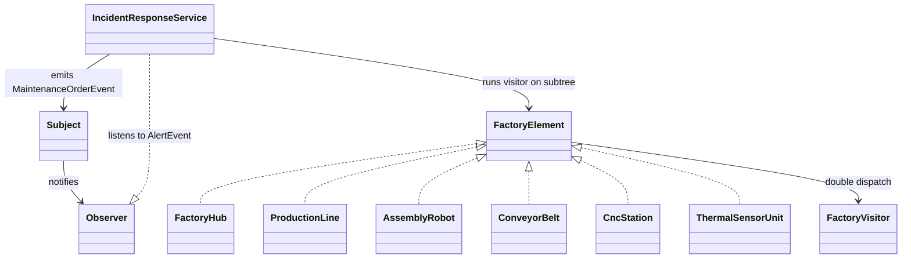

# Industrial IoT Plant Monitoring (Variant 17)

## Design Decisions

### 1. Push vs. Pull Model
We chose the **Push model**. Machine sensors and emergency stop alerts are time-critical and occur unpredictably. Pushing immutable event objects directly to subscribers eliminates polling latency, reduces CPU overhead, and ensures immediate incident response without stale state.

### 2. Traversal Responsibility
We chose **Tree/Composite Delegation**. Container nodes (`FactoryHub`, `ProductionLine`) propagate `accept()` recursively to their children. This keeps Visitor implementations focused purely on calculations and operations, without bloating them with tree-navigation code.

### 3. Concurrency & Thread-Safety (Ch. 13)
* **Lock-Free Registry:** `Subject` uses a `ConcurrentHashMap` combined with `CopyOnWriteArrayList` for listeners. Subscribers can join, leave, or unsubscribe inside their own handlers concurrently without global locking or throwing `ConcurrentModificationException`.
* **Graceful Shutdown:** Producer threads run on an `ExecutorService`. The system uses `CountDownLatch` and `executor.awaitTermination(timeout)` to guarantee zero dropped events prior to thread pool termination.

---

## UML Class Diagram

---

## Hand-Calculated Value Verification

Visitor calculations in `FactoryTest.java` are verified against hand-calculated values for subtree `LINE-A`:

* `AssemblyRobot` (`cost = 100.0`): 100.0 * 2.0 = 200.0
* `ConveyorBelt` (`cost = 50.0`, `length = 20.0`): 50.0 + (20.0 * 1.5) = 80.0
* `CncStation` (`cost = 80.0`): 80.0 * 1.8 = 144.0
* `ThermalSensorUnit` (`cost = 20.0`): 20.0
* **Expected Total Downtime Cost:** 200.0 + 80.0 + 144.0 + 20.0 = 444.0

---

## Trade-off Commits

### Commit 1: Add New Visitor (`CarbonTaxVisitor`)
* **Files changed (1):**
  * `CarbonTaxVisitor.java`
* **Cost:** **O(1) — Zero impact on element classes.** Adding a new operation in the Visitor pattern requires no modifications to the existing hierarchy, adhering to the Open/Closed Principle.

### Commit 2: Add New Element (`AgvForklift`)
* **Files changed (7):**
  * `AgvForklift.java` (new class)
  * `FactoryVisitor.java` (added `visit(AgvForklift)`)
  * `DowntimeCostVisitor.java`
  * `PlantStatusAccumulatorVisitor.java`
  * `OperationalFilterVisitor.java`
  * `JsonExportVisitor.java`
  * `CarbonTaxVisitor.java`
* **Cost:** **O(V) — High cost across all visitors.** Adding an element forces updates to the `Visitor` interface and every existing visitor implementation. This demonstrates the primary drawback of the Visitor pattern when class hierarchies are unstable.
